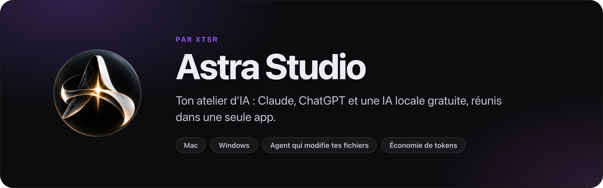

  &nbsp;&nbsp;
  

<a href="https://github.com/XTSR210/astra-studio-releases/releases/latest/download/Astra-Studio-Windows-arm64.exe">Windows ARM (Snapdragon)</a> · <a href="https://github.com/XTSR210/astra-studio-releases/releases">Toutes les versions</a>

Ce dépôt contient uniquement les installateurs d’Astra Studio.

## Installer

1. Clique sur le bouton de ton ordinateur, ci-dessus. Mac : puce Apple (M1 ou plus récent).
2. **Mac** : ouvre le `.dmg`, glisse **Astra Studio** dans **Applications**, puis lance l’app depuis Applications. **Windows** : lance le `.exe` et suis l’assistant.
3. Premier lancement bloqué ?
   - **Mac** : Réglages Système › Confidentialité et sécurité › **Ouvrir quand même**.
   - **Windows** : sur « Windows a protégé votre ordinateur », clique **Informations complémentaires** › **Exécuter quand même**.

Ces alertes viennent de la signature XTSR : c’est un certificat maison, pas encore reconnu par Apple ni Microsoft.

## Mises à jour

Astra se met à jour tout seul : il cherche une nouvelle version au démarrage puis toutes les 4 heures. Il la télécharge en arrière-plan et l’installe quand tu le fermes ; le bouton **Redémarrer maintenant** l’installe tout de suite. Avant la 4.2.15, la mise à jour se fait une seule fois à la main, avec les boutons ci-dessus.
